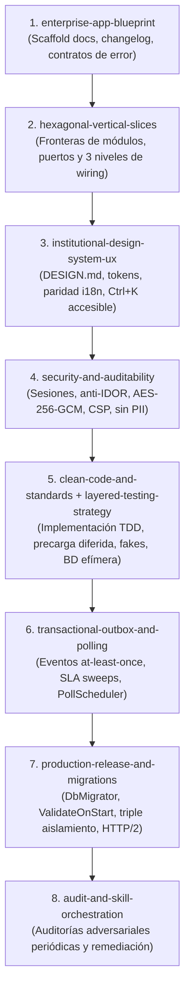

# Enterprise Engineering Kit (`enterprise-engineering-kit`)

[](https://github.com/agent-skills/spec)
[](#instalaci%C3%B3n-y-compatibilidad-multi-agente)
[](#2-hexagonal-vertical-slices)
[](#guardrails-ejecutables-y-herramientas-cicd)
[](#6-institutional-design-system-ux)
[](#4-layered-testing-strategy)

Colección modular de **9 skills estandarizadas de ingeniería de software** diseñadas para guiar a asistentes de inteligencia artificial (Google Antigravity, Anthropic Claude Code, OpenAI Codex, Cursor, Windsurf) y equipos humanos en la creación, refactorización y auditoría de **aplicaciones empresariales e institucionales de misión crítica**.

El kit es **100 % agnóstico de lenguaje y framework** (compatible con TypeScript/JavaScript, C#, Python, Go, Java/Kotlin, Rust, etc.) y opera bajo el principio de **divulgación progresiva (*Progressive Disclosure*)**, optimizando el uso de la ventana de contexto del agente mediante instrucciones ejecutables, manuales de referencia profunda, plantillas de inicio y **guardrails automatizados sin dependencias externas**.

---

## Tabla de Contenidos

1. [Propuesta de Valor e Invariantes Fundacionales](#propuesta-de-valor-e-invariantes-fundacionales)
2. [Anatomía de una Skill (Estándar de la Industria)](#anatom%C3%ADa-de-una-skill-est%C3%A1ndar-de-la-industria)
3. [Catálogo Completo de Skills](#cat%C3%A1logo-completo-de-skills)
   - [1. `enterprise-app-blueprint`](#1-enterprise-app-blueprint)
   - [2. `hexagonal-vertical-slices`](#2-hexagonal-vertical-slices)
   - [3. `clean-code-and-standards`](#3-clean-code-and-standards)
   - [4. `layered-testing-strategy`](#4-layered-testing-strategy)
   - [5. `transactional-outbox-and-polling`](#5-transactional-outbox-and-polling)
   - [6. `institutional-design-system-ux`](#6-institutional-design-system-ux)
   - [7. `security-and-auditability`](#7-security-and-auditability)
   - [8. `production-release-and-migrations`](#8-production-release-and-migrations)
   - [9. `audit-and-skill-orchestration`](#9-audit-and-skill-orchestration)
4. [Flujo Recomendado de Adopción (Ciclo de Vida)](#flujo-recomendado-de-adopci%C3%B3n-ciclo-de-vida)
5. [Guardrails Ejecutables y Herramientas CI/CD](#guardrails-ejecutables-y-herramientas-cicd)
6. [Instalación y Compatibilidad Multi-Agente](#instalaci%C3%B3n-y-compatibilidad-multi-agente)
7. [Estructura del Repositorio](#estructura-del-repositorio)
8. [Gobernanza y Contribución](#gobernanza-y-contribuci%C3%B3n)

---

## Propuesta de Valor e Invariantes Fundacionales

La mayoría de los kits de instrucciones para IA se limitan a listas pasivas de consejos (*prompts*) que se degradan con el tiempo o generan código desordenado. Este kit implementa el estándar riguroso de ingeniería de grado institucional:

* **100 % Agnóstico e Independiente**: Los patrones arquitectónicos, las reglas de concurrencia, las políticas de seguridad y la higiene se aplican con igual rigor en una API en ASP.NET Core / C#, servicios en Go, microservicios en Python o aplicaciones web en Next.js / Vue / Angular.
* **Ley Cero de Integridad de Pruebas (*Anti-Tampering Law*)**: Queda terminantemente prohibido modificar, relajar o silenciar (`skip`) una prueba que falla solo para conseguir un pipeline en verde. Todo fallo se asume como indicio de un defecto real en el código de producción. Solo se admiten saltos condicionales ligados a un entorno o perfil explícito y con motivo escrito (p. ej. una suite de seguridad que corre solo sobre el artefacto compilado).
* **Guardrails Automatizados sin Dependencias**: Incluye **6 scripts en Node.js puro** (`.mjs`, runtime soportado y parcheado verificado) con cero dependencias en `npm`, listos para incorporarse como compuertas obligatorias de pre-commit y CI/CD.
* **Tecnologías sin vulnerabilidades conocidas aplicables**: Las 9 skills exigen [la política de seguridad de tecnologías](skills/security-and-auditability/references/technology-security-policy.md): avisos oficiales vigentes, soporte y verificación de runtimes, dependencias directas/transitivas/de desarrollo, bibliotecas nativas, herramientas de CI, SO e imágenes. Cualquier severidad o comprobación incompleta bloquea la entrega, salvo una excepción documentada con responsable humano, control compensatorio y fecha de vencimiento (vencida, vuelve a bloquear). No se promete ausencia de vulnerabilidades desconocidas.
* **Validación *Fail-Fast* en Arranque y Triple Aislamiento en Disco**: Toda configuración crítica se valida al inicio (`ValidateOnStart`); el servidor mantiene separación física estricta entre carpeta de publicación (reemplazable en deploy), directorio documental persistente (`RootPath`) y anillo de llaves criptográficas/maestra `AES-256-GCM` resguardado fuera del almacenamiento documental.
* **Ergonomía de Teclado, Precarga Diferida y Cero PII en Navegador**: Paleta de comandos global accesible (`Ctrl+K` / `Cmd+K`), precarga diferida filtrada por permisos y con concurrencia acotada, sin saturación de red, carga dinámica (`import()`) de SDKs pesados de autenticación federada y prohibición absoluta de almacenar PII en `localStorage`.
* **Optimización de Contexto (*Progressive Disclosure*)**: Los agentes solo cargan en memoria el nombre y activadores de la skill. El archivo `SKILL.md` se lee únicamente bajo demanda, y las referencias profundas (`references/`) se consultan solo cuando la tarea técnica específica lo exige.
* **Hospedaje Dual (Windows/IIS y Linux/Docker)**: Toda regla operativa trae variante para IIS (configuración residente en el servidor, `web.config`/`appsettings` que el release nunca sobrescribe) y para Docker (configuración por variables de entorno, `.env` o secretos montados, nunca dentro de la imagen; proxy inverso nginx/Traefik). El artefacto de la API nunca contiene configuración por ambiente ni secretos.
* **Gobernanza Documental Estricta**: Modelo de entrada breve (`AGENTS.md`) con derivación a 5 subcarpetas obligatorias y 5 opcionales canónicas en `docs/` y bitácora inmutable (`docs/historial/changelog.md`) con entradas congeladas correlativas `### AAAA-MM-DD (N)`.

---

## Anatomía de una Skill (Estándar de la Industria)

Cada skill del kit sigue estrictamente la arquitectura modular adoptada por los ecosistemas de agentes más avanzados:

```text
skills/<skill-name>/
├── SKILL.md                 # Punto de entrada con frontmatter YAML (name, description, activators)
├── agents/
│   └── openai.yaml          # Metadatos universales para agentes tipo Codex / OpenAI
├── references/              # Documentación técnica profunda, contratos y runbooks operativos
│   └── *.md
├── resources/               # Plantillas listas para andamiaje (.template.md, configs de ejemplo)
│   └── *.template.*
└── scripts/                 # Validadores sin dependencias externas (Node soportado y parcheado)
    └── *.mjs
```

### Contrato de Frontmatter en `SKILL.md`

```yaml
---
name: nombre-de-la-skill
description: >-
  Descripción concisa del problema que resuelve, cuándo debe utilizarse y los
  activadores (palabras clave en lenguaje natural) que despiertan su carga.
---
```

---

## Catálogo Completo de Skills

| # | Skill | Responsabilidad Principal | Activadores Clave | Artefactos Incluidos |
|---|---|---|---|---|
| 1 | [`enterprise-app-blueprint`](#1-enterprise-app-blueprint) | Estructura base de repositorio, gobernanza documental, toolchain centralizado, contrato universal de errores, concurrencia optimista y paginación acotada. | `nuevo proyecto`, `blueprint`, `AGENTS.md`, `contrato de errores`, `concurrencia`, `Directory.Build.props` | Scripts: `scaffold-project-docs`, `check-docs-governance` + plantillas de docs, arquitectura, despliegue y toolchain (.NET/Docker) |
| 2 | [`hexagonal-vertical-slices`](#2-hexagonal-vertical-slices) | Arquitectura Hexagonal simétrica + Vertical Slices backend/frontend, capas como proyectos compilados, convenciones de nombrado y raíces de composición en 3 niveles. | `arquitectura hexagonal`, `vertical slicing`, `ports and adapters`, `boundaries`, `naming` | Script: `check-architecture-boundaries` (con autoprueba y fixtures) + `boundaries.config.example.json` |
| 3 | [`clean-code-and-standards`](#3-clean-code-and-standards) | Política de 0 advertencias, strictness de toolchain (TS/ESLint/.NET), higiene de comentarios, reloj determinista, rendimiento medido (índices, barridos por lote, compresión, budgets) y timeouts escalonados. | `clean code`, `revisión de código`, `código muerto`, `zero warnings`, `rendimiento`, `tsconfig` | Script: `audit-code-hygiene` + 3 guías de referencia |
| 4 | [`layered-testing-strategy`](#4-layered-testing-strategy) | Ley Cero Anti-Tampering, pirámide de pruebas honesta (fakes manuales, fixtures completas, BD efímera, conteo de SQL, pruebas de convención, E2E en dos niveles, cero reintentos). | `tests`, `testing`, `pruebas unitarias`, `fakes`, `disposable database`, `flaky` | Manual: `test-integrity-and-triage` + guías de fakes/fixtures y BD/E2E |
| 5 | [`transactional-outbox-and-polling`](#5-transactional-outbox-and-polling) | Efectos secundarios durables (*at-least-once*), Outbox con leases, jobs de barrido SLA y sondeo disciplinado (`PollScheduler`). | `outbox`, `eventos durables`, `background jobs`, `SLA sweep`, `polling` | Especificaciones de Outbox, leases SQL y `PollScheduler` |
| 6 | [`institutional-design-system-ux`](#6-institutional-design-system-ux) | Tokens semánticos de 2 niveles, paleta `Ctrl+K` accesible (cero PII en `localStorage`), WCAG 2.1 AA e i18n tipada con paridad exacta de claves. | `sistema de diseño`, `tokens`, `WCAG`, `accesibilidad`, `vistas operativas`, `i18n`, `Ctrl+K` | Scripts: `check-design-system`, `check-i18n-parity` + `DESIGN.template.md`, `tokens.template.css` |
| 7 | [`security-and-auditability`](#7-security-and-auditability) | Autorización denegada por defecto, sesiones revocables y rotadas, permisos en BD anti-IDOR, cifrado documental AES-256-GCM con AAD, cabeceras y CSP, integraciones salientes anti-SSRF, cadena de suministro y redacción de PII. | `seguridad`, `autenticación`, `IDOR`, `cifrado`, `CSP`, `rate limiting`, `SSRF`, `logs estructurados` | Especificación criptográfica, matrices IDOR, integraciones salientes y redacción de logs |
| 8 | [`production-release-and-migrations`](#8-production-release-and-migrations) | `DbMigrator` CLI desacoplado de la API (modelo híbrido con script revisable), *Fail-Fast* (`ValidateOnStart`), artefactos sin configuración, hospedaje IIS o Docker, compresión en la aplicación y compuertas CI/CD. | `despliegue`, `CI/CD`, `migraciones`, `DbMigrator`, `health checks`, `producción`, `IIS`, `Docker` | Protocolo `DbMigrator`, checklist de despliegue IIS/Docker y compuertas CI |
| 9 | [`audit-and-skill-orchestration`](#9-audit-and-skill-orchestration) | Coordinación sin solapamientos con skills de auditoría de seguridad (`security-audit`), consistencia UX y entrevista previa. | `auditoría`, `security audit`, `revisión UI/UX`, `orquestación`, `grill me` | Matriz de sinergia entre skills y flujos de remediación |

---

### Detalle de Capacidades por Skill

#### 1. `enterprise-app-blueprint`
Establece los cimientos estructurales y normativos para que una aplicación crezca sin deriva técnica:
* **Entrada documental controlada**: Mantiene `AGENTS.md` como índice ejecutivo breve (≤ 120 líneas), canalizando todo detalle normativo a `docs/`: 5 subcarpetas obligatorias (`arquitectura/`, `reglas/`, `estandares/`, `operacion/`, `historial/`) y 5 opcionales canónicas (`requisitos/`, `guias/`, `decisiones/`, `auditorias/`, `planes/`).
* **Bitácora Inmutable**: Impone `docs/historial/changelog.md` con formato estricto `### AAAA-MM-DD (N)` donde cada registro documenta honestamente alcance, decisiones y verificación.
* **Contrato Universal de Errores e i18n**: Respuestas controladas `{ reason: "STABLE_CODE", details? }` listas para traducción en cliente, también en `401`/`403`, y tipadas en cada endpoint. Las excepciones internas (500) ocultan detalles y retornan un `traceId` único correlacionado con logs del servidor.
* **Concurrencia Optimista por Defecto**: Actualizaciones condicionadas a token de versión (`rowVersion`, `version` o `ETag`) en toda entidad con edición concurrente plausible (incluidos ajustes clave/valor y datos maestros administrados), respondiendo `412 Precondition Failed` ante colisiones.
* **Paginación en Servidor y Baja Lógica**: Prohibición de endpoints que devuelvan colecciones no acotadas a memoria (página por defecto 10, máximo 100, desempate por PK, conteos con tope permitidos); baja lógica (`isActive = false`) y auditoría transversal en entidades operativas, con campos sensibles redactados (`[REDACTED]`).
* **Tope de Texto Simétrico**: Cada texto de entrada declara el mismo máximo en contrato, columna, entidad y `maxlength` del formulario, vigilado por una prueba de reflexión.
* **Toolchain Centralizado**: Plantillas `global.json` (`rollForward: latestPatch`), `Directory.Build.props`, `Directory.Packages.props` (versiones centralizadas), `nuget.config` (`<clear/>`), `.gitattributes` (LF, CRLF solo en `.ps1`/`.cmd`/`.bat`) y `.dockerignore`, más plantillas de documentación de arquitectura, guía por stack y despliegue.

#### 2. `hexagonal-vertical-slices`
Resuelve la organización del código respondiendo simultáneamente a dos preguntas:
* **Dirección de Dependencias (Hexagonal)**: El Dominio (`domain`) no depende de nada externo; la Aplicación (`application`) orquesta casos de uso y define puertos; la Infraestructura (`infrastructure`) implementa los adaptadores; la Presentación (`ui` / `api`) solo consume puertos de entrada.
* **Propiedad de Negocio (Vertical Slices)**: Cada funcionalidad (`features/<nombre-feature>/`) encapsula sus casos de uso, contratos y adaptadores, erradicando carpetas horizontales genéricas y desordenadas.
* **Capas Compiladas y Nombrado Uniforme**: Cada capa es un proyecto/paquete con grafo de referencias acíclico, un proyecto de pruebas por proyecto de código, registro DI explícito (sin mediadores, mapeadores automáticos ni escaneo por reflexión) y una tabla de nombres común para casos de uso, adaptadores, controladores, eventos y tokens.
* **Composición por Alcance y Carga Diferida Real (sin anular el code-splitting)**:
  * *Nivel global (`app.config`)*: Exclusivamente fontanería transversal (router con precarga diferida por permisos, cliente HTTP e interceptores, error handler, i18n base y wiring mínimo de sesión para `authGuard`). **Prohibido** registrar casos de uso o adaptadores de features aquí, ya que arrastraría sus módulos al bundle inicial.
  * *Nivel shell autenticada (`''` en `app.routes`)*: Wiring compartido por 2 o más features activas tras iniciar sesión (notificaciones/heartbeat de cabecera, borrador compartido), sin duplicarlo ni subirlo a `app.config`.
  * *Nivel de ruta diferida (`loadChildren` → `<feature>.routes`)*: Cada feature declara sus propios `providers` (adaptador HTTP + casos de uso + stores). Los adaptadores de librerías voluminosas y condicionales (ej. SDKs de SSO/OIDC) las cargan con `import()` dinámico en su primer uso.

#### 3. `clean-code-and-standards`
Garantiza precisión y mantenibilidad con reglas no negociables:
* **0 Advertencias**: Configuración de compiladores y analizadores con tratamiento de advertencias como errores (`treat warnings as errors`).
* **Higiene Quirúrgica de Comentarios**: Prohibición de narrativa histórica ("corregido según auditoría", "a pedido del usuario") o paráfrasis obvia. Los comentarios explican exclusivamente invariantes técnicas no obvias o limitaciones de integraciones externas.
* **Reloj Inyectado**: Prohibición del uso estático o directo del reloj del sistema (`DateTime.UtcNow`, `new Date()`, `time.Now()`) en dominios o casos de uso; siempre se inyecta un proveedor de tiempo abstracto para garantizar pruebas deterministas.
* **Rendimiento Real en Cliente Web y Red HTTP**:
  * *Precarga diferida, filtrada por permisos y con concurrencia acotada*: Nunca usar `PreloadAllModules` inmediato al arrancar; bajo HTTP/1.1 (límite de 6 conexiones por origen) satura la red y provoca timeouts en llamadas iniciales. Precargar solo los módulos que el usuario puede abrir, después de la primera navegación autenticada, cediendo la red al navegar y con pocas descargas simultáneas. El disparador puede ser `requestIdleCallback` o un temporizador.
  * *Interceptor de resiliencia sin reintentos de `TimeoutError`*: Un timeout bajo congestión indica encolamiento; reintentarlo agrava el cuello de botella. Solo reintentar fallos reales de transporte (`status === 0`) en lecturas idempotentes (`GET`).
  * *Consultas paralelas y campos computados*: Paralelización de lecturas de vista con `Promise.all` y formateos precalculados con señales/selectores memoizados (`computed()`) en lugar de invocar métodos por cada fila en plantillas.
  * *Carga bajo demanda (`import()` dinámico)* de SDKs federados pesados (~250+ kB) y **tipografías auto-hospedadas (`.woff2`)** para eliminar llamadas externas a Google Fonts en runtime y blindar la CSP.
* **Strictness de Toolchain**: `tsconfig` estricto (`noUncheckedIndexedAccess`, `noImplicitOverride`, `noPropertyAccessFromIndexSignature`, etc.), ESLint en error (imports ascendentes, `consistent-type-imports`, preset de accesibilidad, prohibición de *bypass* del sanitizador) y `.editorconfig` C# con IDE0005/IDE0001/IDE0065.
* **Rendimiento de Datos Medido**: Toda corrección se mide antes/después sobre BD desechable con volumen realista; índices filtrados y columnas calculadas para listados y barridos, predicados sargables, barridos por lote sin costo cuadrático del ORM, correlativos por upsert atómico, compresión JSON en la propia aplicación (excluyendo secretos por BREACH), cupos de CPU/descarga y presupuestos de bundle.
* **Escalonamiento de Timeouts SQL y Reintentos Idempotentes**:
  * `CommandTimeout` de base de datos en API (`10 s`) por debajo del timeout HTTP del cliente (`15 s`) para trazas limpias; extendido en `DbMigrator` (`5 min`).
  * Transacciones manuales envueltas en `ExecutionStrategy` con idempotencia garantizada.

#### 4. `layered-testing-strategy`
Implementa una suite de pruebas predecible y honesta:
* **Ley Cero Anti-Tampering**: Si un test falla, la presunción absoluta es que existe un defecto real en el código de producción. Queda prohibido modificar la prueba, cambiar sus aserciones o marcarla como `skip` para forzar el verde en CI. Un salto condicional a un perfil explícito, con motivo escrito, no es manipulación.
* **Pirámide por Responsabilidad**:
  * *Dominio*: Pruebas unitarias puras y ultrarrápidas sin dobles de prueba.
  * *Casos de Uso*: Pruebas con fakes explícitos en memoria (escritos a mano con interfaces limpias), evitando librerías de mocking acopladas a la implementación interna.
  * *Componentes / UI*: Fixtures completas e inyección del motor real de traducciones (i18n), verificando accesibilidad e interactividad.
  * *Integración*: Ejecución contra instancias reales y efímeras de base de datos (descartables por suite), con limpieza transaccional obligatoria.
  * *Integración con conteo de SQL*: Lectores paginados o con caché afirman el número exacto de comandos SQL (detecta N+1 y conteos de más).
  * *Pruebas de convención por reflexión*: Invariantes transversales de la API (topes de texto, filtros de capacidad, contrato de falla) verificadas enumerando endpoints y contratos.
  * *E2E en dos niveles*: UI/layout/accesibilidad con API simulada, y specs `-real` contra BD desechable (LocalDB en Windows, contenedor en Linux/Docker) para todo flujo que escribe datos; anchos 360/768/1280, Alto Contraste y movimiento reducido.
  * *Cero reintentos*: `retries: 0`, sin pausas fijas, timeouts justificados y suites con estado compartido en serie.

#### 5. `transactional-outbox-and-polling`
Manejo disciplinado de la asincronía y el tiempo real sin introducir complejidad innecesaria:
* **Outbox Transaccional**: Registro atómico de eventos y efectos secundarios (envío de correos, generación de PDFs, webhooks) dentro de la misma transacción de base de datos del negocio.
* **Workers con Leases y Heartbeat**: Despachadores en segundo plano con bloqueo optimista/leasings para garantizar entrega *at-least-once* y evitar procesamiento concurrente duplicado.
* **Barrido de Plazos (SLA Sweeper)**: Procesos periódicos de base de datos para vigilar vencimientos, estados estancados o alertas preventivas sin intervención del usuario.
* **`PollScheduler` en Cliente**: Mecanismo de sondeo periódico disciplinado con retroceso exponencial, pausa cuando la pestaña está en segundo plano y detección de cambios de red, ideal para entornos con proxies institucionales donde SSE o WebSockets son inestables.

#### 6. `institutional-design-system-ux`
Diseño de software empresarial centrado en la usabilidad, la ergonomía y la accesibilidad:
* **Sistema de Tokens de Dos Niveles**:
  1. *Tokens Primitivos / Globales*: Paleta cruda (`--brand-blue-500`, `--neutral-100`).
  2. *Tokens Semánticos de Decisión*: Propósito contextual explícito (`--color-surface-card`, `--color-border-interactive`, `--text-danger`). El código de producción consume **únicamente tokens semánticos**.
* **Patrones Operativos Densos y Paleta de Comandos (`Ctrl+K` / `Cmd+K`)**:
  * Expedientes, asistentes multi-etapa con preservación de estado, tablas con transformación automática a tarjetas móviles y modales seguros.
  * *Paleta de comandos accesible*: Diálogo modal con `role="combobox"`, sincronización `aria-activedescendant` al navegar con flechas, ejecución con `Enter`, `Escape` y devolución limpia del foco. Búsquedas con debounce y cancelación inmediata de peticiones en vuelo.
  * *Higiene estricta de `localStorage` (Cero PII)*: En la lista de recientes, almacenar exclusivamente rutas o claves estáticas de navegación (`"nav.incidents"`). Prohibido almacenar expedientes, nombres o datos de usuarios; purga automática de entradas heredadas.
* **Accesibilidad WCAG 2.1 AA**: Paridad de foco obligatoria (`:focus-visible` explícito; prohibido `outline: none` sin reemplazo visible). El anillo con `box-shadow` va acompañado de `outline: 2px solid transparent` para que sobreviva al Alto Contraste del sistema (`forced-colors`). Ratios de contraste documentados junto a cada token y comprobados con una herramienta nombrada, y navegación íntegra por teclado.
* **Accesibilidad Operativa**: Preset de lint de accesibilidad de plantillas, enlace de salto y gestión de foco, título de página traducido por ruta, validación de formularios con `aria-invalid`/`aria-describedby` solo con error y foco al primer campo inválido, y fechas con formato institucional sin `toISOString()` en valores locales.
* **Internacionalización y Paridad de Diccionarios**: `<html lang>` sincronizado e idioma persistido aplicado antes del primer render. Cero cadenas literales en plantillas HTML. Validación estática obligatoria de paridad exacta de claves, interpolación y traducciones no vacías en todos los idiomas, y de que toda clave usada en el código exista en los diccionarios.

#### 7. `security-and-auditability`
Seguridad defensiva en profundidad desde las bases del código:
* **Autorización Denegada por Defecto**: Política de respaldo que exige sesión autenticada en todo endpoint; lo anónimo es excepción inventariada y probada. Protección del último administrador activo bajo bloqueo transaccional.
* **Sesiones Revocables con Sello de Versión**: Cada solicitud valida el `security_version` del usuario en sesión/base de datos, permitiendo invalidación instantánea ante cambio de credenciales o cierre forzado. Rotación de sesión en cada login, cookies `__Host-` (`Secure`, `HttpOnly`, `SameSite=Lax`/`Strict`, `Path=/`), máximo absoluto de sesión y tickets/llaves persistidos fuera del proceso (sobreviven reciclados y contenedores).
* **Identidad Federada y Rate Limiting**: Validación de emisor, audiencia, vigencia y *scope* del token del IdP, canjeado una vez por sesión de servidor; IP real solo desde proxies declarados; cuotas por operación costosa con `429` + `Retry-After` + `reason`.
* **Integraciones Salientes y Cadena de Suministro**: Clientes HTTP con endpoint HTTPS validado al arrancar, timeout, tope de respuesta y sin redirecciones (anti-SSRF); identidad administrada o certificado en lugar de secretos; herramientas de CI fijadas con SHA-256 y excepciones de vulnerabilidades en archivo leído por la compuerta.
* **Autorización en Base de Datos y Alcance Anti-IDOR**: Las consultas y mutaciones filtran obligatoriamente por la organización o tenencia del usuario (`tenantId`, `organizationId`) en la consulta SQL/ORM, impidiendo la manipulación de identificadores en la URL.
* **Cifrado Documental en Repositorio**: Cifrado de documentos confidenciales mediante `AES-256-GCM` con Datos Asociados Autenticados (`AAD`), vinculando criptográficamente el archivo a la entidad que lo posee.
* **Cabeceras de Endurecimiento**: CSP estricto con `nonces` o hashes (también en la API), Trusted Types para neutralizar inyecciones DOM-XSS, `nosniff`, `Referrer-Policy`, `Cache-Control: no-store` por defecto, CORS en lista blanca exacta, Swagger y endpoints de diagnóstico solo en Desarrollo, y protección anti-CSRF por token sincronizado.
* **Bitácora Estructurada sin Fugas de Información**: Formato JSON estructurado con correlación mediante `traceId` y redacción automática obligatoria de contraseñas, tokens y datos sensibles (PII).

#### 8. `production-release-and-migrations`
Entrega confiable y reproducible en servidores empresariales:
* **Validación *Fail-Fast* en el Arranque (`ValidateOnStart`)**:
  * Toda sección de configuración (conexiones, orígenes HTTPS, presupuestos de memoria, Outbox, llaves criptográficas) se valida en el arranque del proceso; si falta un valor crítico (ej. llave de cifrado documental), la API **se niega a arrancar de inmediato** en lugar de degradarse en silencio a texto plano o fallar a mitad de una transacción.
* **Triple Separación Física en Servidor**:
  1. *Carpeta de publicación* (reemplazada en cada deploy): Jamás almacena secretos, logs ni documentos de usuarios.
  2. *Directorio documental (`RootPath`)*: Carpeta externa persistente con ACL exclusivo para la identidad del proceso.
  3. *Llave maestra `AES-256-GCM` y anillo de claves*: Resguardados y respaldados **fuera del directorio documental** (guardar la llave junto a los archivos anula la protección ante copia de carpeta).
* **Servidor Web y Red**:
  * **HTTP/2 activo** sobre HTTPS/TLS 1.2+ (elimina el cuello de botella de 6 conexiones de HTTP/1.1), compresión estática de la SPA y **compresión JSON en la propia aplicación** (nunca compresión dinámica del servidor para la API); host endurecido (sin `Server`/`X-Powered-By`, topes de URL, query y encabezados) y TLS validado hacia la base de datos.
* **Hospedaje IIS o Docker**: En IIS, `Preload Enabled`, reciclado periódico desactivado y configuración residente que el release no sobrescribe; en Docker, configuración por entorno/secretos, healthcheck de readiness y volúmenes para documentos y llaves. En ambos, servicio de calentamiento del ORM.
* **Separación de Privilegios en Base de Datos**:
  * La API de producción **nunca ejecuta DDL ni crea usuarios privilegiados al iniciar**. Las migraciones se gestionan mediante la herramienta CLI independiente `DbMigrator` (modelo híbrido): migración directa solo en Desarrollo sobre loopback; `--target-database` coincidente en cualquier destino remoto; CI genera script idempotente + manifiesto `SHA-256` como artefacto de revisión que no despliega; el release aplica tras respaldo comprobado (`--reviewed-sha256`/`--backup-ticket` opcionales y recomendados). Incluye `--dry-run` de solo lectura, semillas que solo insertan y ventana de bajo uso para DDL bloqueante.
* **Compuertas de Calidad CI/CD**: Pipeline de compuertas automatizadas (secretos, dependencias, build, pruebas, manifiesto de artefactos reverificado en el release) antes de autorizar el paso a producción; número de build visible en la UI.

#### 9. `audit-and-skill-orchestration`
Establece la coordinación armónica y sin conflictos entre las skills del kit y herramientas externas especializadas:
* **Auditoría de Seguridad Adversarial**: Este kit define los controles constructivos; la auditoría ofensiva y de penetración delega en `security-audit` (modo solo lectura, clasificación `confirmed` / `needs_validation` y artefactos fuera del repo).
* **Consistencia Visual y Ergonomía UI**: Coordina con `design-consistency-auditor`, `ui-ux-pro-max` e `impeccable` respetando la jerarquía donde el archivo `DESIGN.md` del proyecto es la autoridad suprema.
* **Interrogatorio de Diseño y Documentación Viva**: Integración fluida con `grilling` para resolver decisiones críticas antes de codificar y con `context7-mcp` para verificar firmas exactas de versiones instaladas de librerías.
* **Skills Compañeras Fijadas**: `skills-lock.json` versionado con fuente y hash SHA-256 de cada skill compañera; un hash distinto detiene la carga.

---

## Flujo Recomendado de Adopción (Ciclo de Vida)



---

## Guardrails Ejecutables y Herramientas CI/CD

El kit provee **6 herramientas automáticas de validación** desarrolladas en Node.js puro (`.mjs`, runtime soportado y parcheado verificado) con **cero dependencias externas** (no requieren `npm install`). Pueden ejecutarse localmente o incorporarse a cualquier pipeline de integración continua.

Antes de ejecutarlas, verificar el runtime contra los avisos oficiales vigentes. [.node-version](.node-version) fija Node.js `24.22.1`, parche publicado para los avisos de octubre de 2026 y verificado el 2026-10-27; debe revisarse ante nuevos avisos, junto con cualquier biblioteca integrada y los runtimes usados por las acciones de CI. El archivo no actualiza automáticamente el Node instalado ni certifica versiones futuras. Los 6 validadores comprueban calidad estructural; cada proyecto debe implementar además la compuerta obligatoria de seguridad descrita en la política.

### 1. `scaffold-project-docs.mjs`
Inicializa el gobierno documental del proyecto generando `AGENTS.md`, `DESIGN.md`, `.editorconfig`, `.gitattributes`, `.gitignore`, las subcarpetas de `docs/` con plantillas de arquitectura, guía y despliegue, el informe inicial `docs/auditorias/seguridad-tecnologias.md` y la primera entrada en `changelog.md`. `--dotnet` agrega `global.json`, `Directory.Build.props`, `Directory.Packages.props` y `nuget.config`; `--docker` agrega `.dockerignore`:
```bash
node skills/enterprise-app-blueprint/scripts/scaffold-project-docs.mjs --target . --name "NombreProyecto" [--dotnet] [--docker] [--force]
```

### 2. `check-docs-governance.mjs`
Verifica que `AGENTS.md` permanezca conciso (≤ 120 líneas); que no existan archivos sueltos de ninguna extensión en la raíz de `docs/`; que todos los encabezados del `changelog.md` sean correlativos, sin duplicados y en orden descendente (`--changelog-from N` excluye historial heredado); que existan y estén enlazados la política e informe de seguridad de tecnologías; que no haya enlaces relativos rotos; y, con `--e2e-dir`, que los specs E2E en disco coincidan con el registro de `AGENTS.md`:
```bash
node skills/enterprise-app-blueprint/scripts/check-docs-governance.mjs --root . [--max-agents-lines 120] [--changelog-from N] [--e2e-dir e2e]
```

### 3. `check-architecture-boundaries.mjs`
Validador agnóstico de fronteras arquitectónicas (Hexagonal + Vertical Slices). Verifica que el dominio no importe capas externas y que no haya dependencias cruzadas indebidas entre features:
```bash
node skills/hexagonal-vertical-slices/scripts/check-architecture-boundaries.mjs --config ./boundaries.config.json [--root .]
```
*Soporta análisis estático de código en:* TypeScript, JavaScript, Python, Go, C#, Java, Kotlin y Rust. Inspecciona también las pruebas (exentas solo de las reglas por capa), prohíbe paquetes externos por capa (`forbiddenPackagesByLayer`), detecta nombres calificados en línea en C# e imports duplicados. Autoprueba con fixtures:
```bash
node --test skills/hexagonal-vertical-slices/scripts/check-architecture-boundaries.test.mjs
```

### 4. `audit-code-hygiene.mjs`
Audita la base de código detectando narrativa conversacional en comentarios, supresiones evasivas sin justificar, uso directo de relojes del sistema y pruebas silenciadas (`skip` / `@Disabled`):
```bash
node skills/clean-code-and-standards/scripts/audit-code-hygiene.mjs --root . --scan src,backend
```

### 5. `check-design-system.mjs`
Valida el cumplimiento estricto del sistema de diseño:
* Detecta colores hexadecimales literales fuera del archivo de tokens.
* Bloquea el consumo directo de tokens primitivos (`--brand-*`).
* Prohíbe `transition: all`.
* Verifica escalas tipográficas (`font-scale`, `leading-scale`, `font-weight-scale`), tarjetas planas en reposo (`flat-at-rest`), sombras y halos literales (`shadow-literal`, `shadow-ring-literal`) y toasts con texto literal; cada check se puede omitir con `--skip-checks`.
* Exige paridad de foco accesible por regla y selector (prohíbe `outline: none` sin indicador `:focus-visible`) y, con `--require-forced-colors-focus`, el contorno transparente para Alto Contraste.
* Detecta cadenas de texto sin traducir en plantillas UI, incluidos `aria-label`, `title`, `placeholder` y `alt`, sin confundir expresiones del framework con texto.
* Acepta marcadores de excepción del proyecto mediante alias (`--marker-alias`) y prefijos de primitivos configurables (`--primitive-prefix`).
```bash
node skills/institutional-design-system-ux/scripts/check-design-system.mjs \
  --root . \
  --styles src/styles \
  --app src/app \
  --tokens src/styles/tokens.css
```

### 6. `check-i18n-parity.mjs`
Validador estático de paridad e integridad de diccionarios de internacionalización (Node.js soportado y parcheado, cero dependencias). Soporta simultáneamente diccionarios raíz (`public/i18n/{es,en}.json`) y scopes anidados (`public/i18n/<scope>/{es,en}.json`):
* Comprueba la presencia de todos los idiomas requeridos en cada scope.
* Valida sintaxis JSON estricta.
* Garantiza paridad exacta de árbol de claves (cero claves faltantes o huérfanas entre idiomas).
* Prohíbe traducciones vacías o compuestas únicamente por espacios en blanco.
* Verifica la correspondencia exacta de variables interpoladas (`{{param}}` y `{param}`).
* Con `--check-usage <dirs>`, detecta claves literales usadas en el código que no existen en los diccionarios.
```bash
node skills/institutional-design-system-ux/scripts/check-i18n-parity.mjs \
  --root . \
  --i18n public/i18n \
  --langs es,en
```

### Ejemplo de Integración en GitHub Actions

```yaml
name: Enterprise Quality & Architecture Gate

on:
  push:
    branches: [main, develop]
  pull_request:
    branches: [main, develop]

permissions:
  contents: read

jobs:
  guardrails:
    runs-on: ubuntu-latest
    steps:
      - name: Checkout Code
        uses: actions/checkout@3d3c42e5aac5ba805825da76410c181273ba90b1 # v7.0.1
        with:
          persist-credentials: false

      - name: Setup Node.js (versión exacta revisada)
        uses: actions/setup-node@949feb2413d6458794dcd2491c4babbbce0c15c1 # v7.1.0
        with:
          node-version-file: .node-version
          package-manager-cache: false

      - name: Check Documentation Governance
        run: node skills/enterprise-app-blueprint/scripts/check-docs-governance.mjs --root .

      - name: Audit Code Hygiene & Anti-Tampering Law
        run: node skills/clean-code-and-standards/scripts/audit-code-hygiene.mjs --root . --scan src

      - name: Check Architecture Boundaries
        run: node skills/hexagonal-vertical-slices/scripts/check-architecture-boundaries.mjs --config boundaries.config.json --root .

      - name: Check Design System & Accessibility
        run: node skills/institutional-design-system-ux/scripts/check-design-system.mjs --root .

      - name: Check i18n Parity & Integrity
        run: node skills/institutional-design-system-ux/scripts/check-i18n-parity.mjs --root . --i18n public/i18n --langs es,en
```

---

## Instalación y Compatibilidad Multi-Agente

Este repositorio implementa las especificaciones estándar de la industria, garantizando interoperabilidad inmediata con los principales agentes y entornos de desarrollo:

### 1. Google Antigravity

#### En un proyecto específico
Crea o edita `.agents/skills.json` en la raíz de tu proyecto para apuntar a la carpeta `skills`:
```json
{
  "entries": [
    {
      "path": "/ruta/absoluta/a/My_Project_Skills/skills"
    }
  ]
}
```

O hereda directamente el manifiesto raíz del kit:
```json
{
  "inherits": [
    {
      "path": "/ruta/absoluta/a/My_Project_Skills/skills.json"
    }
  ]
}
```

#### Disponibilidad Global en tu máquina
Para tener las 9 skills disponibles en todos los espacios de trabajo de Antigravity, añade la entrada anterior en tu configuración de usuario:
* **Linux / macOS**: `~/.gemini/config/skills.json`
* **Windows**: `%USERPROFILE%\.gemini\config\skills.json`

---

### 2. Skills CLI (`npx skills`)

Instala las skills de forma interactiva en cualquier repositorio utilizando el gestor estándar de la comunidad:
```bash
# Instalar todo el kit globalmente en tu máquina
npx skills add /ruta/a/My_Project_Skills -g

# O instalar una skill específica en el proyecto actual
npx skills add /ruta/a/My_Project_Skills --skill hexagonal-vertical-slices
```

---

### 3. Anthropic Claude Code

Para utilizar el kit en Claude Code, puedes clonar o enlazar el repositorio dentro de tu espacio de trabajo o registrar la ruta en la configuración:

```bash
# Enlace simbólico de las skills al directorio local de Claude
mkdir -p .claude/skills
ln -s /ruta/a/My_Project_Skills/skills/* .claude/skills/
```

Alternativamente, enlaza los archivos `SKILL.md` en tu `CLAUDE.md` como guías de ejecución mandatorias.

---

### 4. OpenAI Codex / ChatGPT / Cursor / Windsurf

Cada skill incluye su archivo de manifiesto universal `agents/openai.yaml`. Para integrar el kit en entornos basados en Codex o editores con soporte de reglas:

* **OpenAI Codex**: Enlaza las carpetas de las skills dentro de `~/.codex/skills/` o en el directorio `.codex/skills/` de tu repositorio.
* **Cursor / Windsurf**: Copia o referencia los principios en `.cursorrules` o `.windsurfrules`, integrando la ejecución de los scripts de guardrails en los comandos de compilación/linting.

#### Script de Enlace Rápido (POSIX / macOS / Linux)
```bash
DEST="$HOME/.codex/skills"
mkdir -p "$DEST"
for skill in skills/*; do
  if [ -d "$skill" ]; then
    ln -s "$(pwd)/$skill" "$DEST/$(basename "$skill")"
  fi
done
```

#### Script de Enlace Rápido (Windows PowerShell)
```powershell
$Dest = "$HOME\.codex\skills"
New-Item -ItemType Directory -Force -Path $Dest | Out-Null
Get-ChildItem ".\skills" -Directory | ForEach-Object {
  New-Item -ItemType SymbolicLink -Path (Join-Path $Dest $_.Name) -Target $_.FullName -Force
}
```

---

## Estructura del Repositorio

```text
My_Project_Skills/
├── README.md                                   # Documentación técnica maestra del kit
├── plugin.json                                 # Descriptor de plugin de Antigravity
├── skills.json                                 # Manifiesto de descubrimiento de skills
└── skills/
    ├── enterprise-app-blueprint/               # Estructura base, AGENTS.md, docs, contratos y changelog
    │   ├── SKILL.md
    │   ├── agents/openai.yaml
    │   ├── references/                         # Contratos de API, errores, gobierno documental
    │   ├── resources/                          # Plantillas AGENTS, changelog, reglas, arquitectura, despliegue, toolchain .NET/Docker
    │   └── scripts/                            # scaffold-project-docs.mjs, check-docs-governance.mjs
    ├── hexagonal-vertical-slices/              # Arquitectura Hexagonal + Vertical Slices simétrica
    │   ├── SKILL.md
    │   ├── agents/openai.yaml
    │   ├── references/                         # Anatomía de slices backend y frontend (wiring 3 niveles)
    │   ├── resources/                          # boundaries.config.example.json
    │   └── scripts/                            # check-architecture-boundaries.mjs + autoprueba y fixtures
    ├── clean-code-and-standards/               # 0 advertencias, higiene, reloj inyectado, rendimiento y timeouts
    │   ├── SKILL.md
    │   ├── agents/openai.yaml
    │   ├── references/                         # Guías de comentarios, nulos, concurrencia y cliente web
    │   └── scripts/                            # audit-code-hygiene.mjs
    ├── layered-testing-strategy/               # Ley Cero Anti-Tampering, fakes, BD efímera, E2E
    │   ├── SKILL.md
    │   ├── agents/openai.yaml
    │   └── references/                         # test-integrity-and-triage.md, guías de fakes y BD
    ├── transactional-outbox-and-polling/       # Outbox transaccional, leases SQL, SLA sweep, PollScheduler
    │   ├── SKILL.md
    │   ├── agents/openai.yaml
    │   └── references/                         # Runbook de Outbox, especificaciones técnicas
    ├── institutional-design-system-ux/         # Tokens de 2 niveles, WCAG 2.1 AA, Ctrl+K, sin PII, i18n
    │   ├── SKILL.md
    │   ├── agents/openai.yaml
    │   ├── references/                         # Tokens semánticos, UX densa, feedback patterns, paleta Ctrl+K
    │   ├── resources/                          # DESIGN.template.md, tokens.template.css
    │   └── scripts/                            # check-design-system.mjs, check-i18n-parity.mjs
    ├── security-and-auditability/              # Sesiones revocables, anti-IDOR, AES-256-GCM, CSP, PII
    │   ├── SKILL.md
    │   ├── agents/openai.yaml
    │   └── references/                         # Especificaciones criptográficas, matrices de permisos, integraciones salientes
    ├── production-release-and-migrations/      # DbMigrator desacoplado, ValidateOnStart, triple aislamiento, CI/CD
    │   ├── SKILL.md
    │   ├── agents/openai.yaml
    │   └── references/                         # Protocolo DbMigrator, pipelines, HTTP/2 y checklist post-deploy
    └── audit-and-skill-orchestration/          # Coordinación con security-audit, UI/UX skills y grilling
        ├── SKILL.md
        ├── agents/openai.yaml
        └── references/                         # companion-skills-matrix.md
```

---

## Gobernanza y Contribución

Para proponer una nueva skill o modificar una existente dentro de este kit, es obligatorio mantener las siguientes condiciones del estándar:

1. **Cumplimiento del Esquema**: Toda skill debe residir en `skills/<nombre>/`, contar con un `SKILL.md` con frontmatter YAML válido (`name` y `description` con activadores explícitos) y su correspondiente `agents/openai.yaml`.
2. **Independencia Tecnológica**: Las instrucciones y patrones deben formularse de forma agnóstica de frameworks o lenguajes específicos, delegando detalles concretos a ejemplos o decoradores.
3. **Cero Dependencias en Scripts**: Cualquier herramienta de validación debe implementarse en JavaScript estándar (`.mjs`, Node.js soportado y parcheado verificado según la política de tecnologías) utilizando exclusivamente los módulos nativos de Node (`node:fs`, `node:path`, `node:url`, etc.).
4. **Verificación de Enlaces e Higiene**: Ningún documento Markdown debe contener enlaces relativos rotos, y las referencias normativas deben derivar a `references/` o `resources/` sin duplicar texto.

---

## Licencia

Distribuido bajo la Licencia MIT. Libre para uso, adaptación y distribución en proyectos comerciales, institucionales y de código abierto.
